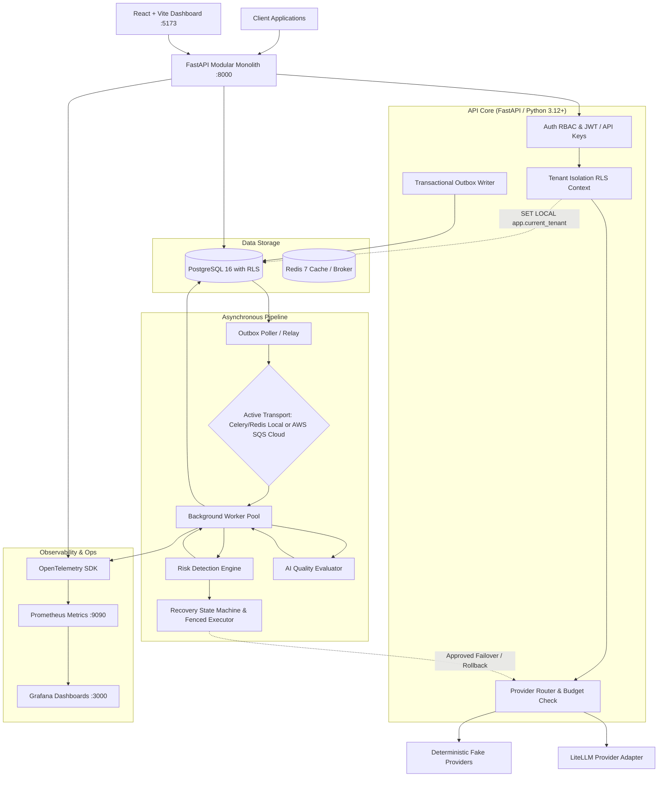

# SentinelAI — MASTER AUTHOR & SYSTEM NAVIGATOR

> **Purpose:** Single source of truth, low-token navigation directory, full step index (Days 1–90), tech stack reference, and live project state tracker for SentinelAI.  
> **Location:** Root directory (`/MASTER_AUTHOR.md`)  
> **Protocol:** Whenever any code, configuration, or documentation change is made to the project, update the **Live Project State & Change Log** section at the bottom of this document.

---

## Table of Contents
1. [Token-Efficient Quick-Jump Directory (Where is Everything?)](#1-token-efficient-quick-jump-directory)
2. [Prompt Recipes & Intent-Based Context Guide](#2-prompt-recipes--intent-based-context-guide)
3. [Master Architecture & Tech Stack Matrix](#3-master-architecture--tech-stack-matrix)
4. [Comprehensive 90-Day Step Registry](#4-comprehensive-90-day-step-registry)
   - [Week 1: Foundation & Architecture (Days 01–07)](#week-1--foundation-and-architecture-days-0107)
   - [Week 2: Auth, Tenant Isolation (RLS) & Audit (Days 08–14)](#week-2--auth-tenant-isolation-rls-and-audit-days-0814)
   - [Week 3: LLM Gateway & Idempotency (Days 15–21)](#week-3--llm-gateway-and-idempotency-days-1521)
   - [Week 4: Async Telemetry, Outbox & Workers (Days 22–28)](#week-4--async-telemetry-outbox-and-workers-days-2228)
   - [Week 5: Metrics, Costs & React Dashboard (Days 29–35)](#week-5--metrics-costs-and-react-dashboard-days-2935)
   - [Week 6: Risk Detection & Incident Response (Days 36–42)](#week-6--risk-detection-and-incident-response-days-3642)
   - [Week 7: AI Quality Evaluation & 200-Case Benchmark (Days 43–49)](#week-7--ai-quality-evaluation-and-200-case-benchmark-days-4349)
   - [Week 8: Safe Recovery Orchestrator (Days 50–56)](#week-8--safe-recovery-orchestrator-days-5056)
   - [Week 9: Reliability, Chaos & Security Hardening (Days 57–63)](#week-9--reliability-chaos-and-security-hardening-days-5763)
   - [Week 10: Scalability & Locust Load Benchmarks (Days 64–70)](#week-10--scalability-and-locust-load-benchmarks-days-6470)
   - [Week 11: Cost-Conscious AWS Infrastructure (Days 71–77)](#week-11--cost-conscious-aws-infrastructure-days-7177)
   - [Week 12: Production Verification, Docs & Release (Days 78–84)](#week-12--production-verification-docs-and-release-days-7884)
   - [Optional Week 13: Advanced Labs (Kafka, LangGraph, K8s) (Days 85–90)](#optional-week-13--advanced-labs-days-8590)
5. [Live Project State & Change Log Tracker](#5-live-project-state--change-log-tracker)

---

## 1. Token-Efficient Quick-Jump Directory

> **Agent/Developer Optimization Note:** To save LLM tokens, **do not load the entire codebase**. Use this directory to load only the specific files and step guides relevant to your immediate task.

| Domain / Subsystem | Primary Code Path | Config / Schema Path | Associated Steps | Primary Tech Stack |
|---|---|---|---|---|
| **Frontend UI & Dashboard** | `frontend/src/` | `frontend/package.json`, `vite.config.ts`, `tailwind.config.js` | [Day 032](steps/step-032.md)–[Day 035](steps/step-035.md), [Day 041](steps/step-041.md), [Day 055](steps/step-055.md) | React 18, TypeScript, Vite, Tailwind CSS, Recharts, Lucide Icons |
| **API Server & Routing** | `backend/app/api/` | `backend/app/main.py`, `backend/app/core/config.py` | [Day 006](steps/step-006.md), [Day 012](steps/step-012.md), [Day 031](steps/step-031.md), [Day 041](steps/step-041.md) | FastAPI, Pydantic v2, Python 3.12+ |
| **Auth, RLS & Multi-Tenancy** | `backend/app/auth/`, `backend/app/models/tenant.py` | `backend/alembic/versions/` (RLS policies) | [Day 008](steps/step-008.md)–[Day 014](steps/step-014.md), [Day 060](steps/step-060.md) | PostgreSQL 16 RLS, Argon2, JWT, Scoped API Keys, Append-only Audit |
| **LLM Gateway & Adapters** | `backend/app/gateway/` | `backend/app/models/provider.py`, `backend/app/gateway/router.py` | [Day 015](steps/step-015.md)–[Day 021](steps/step-021.md) | LiteLLM, Deterministic Mock Providers, Idempotency claims |
| **Database & Migrations** | `backend/app/db/`, `backend/app/models/` | `backend/alembic/`, `backend/alembic.ini` | [Day 004](steps/step-004.md), [Day 005](steps/step-005.md), [Day 009](steps/step-009.md), [Day 067](steps/step-067.md) | PostgreSQL 16, async SQLAlchemy 2.0, Alembic |
| **Outbox & Asynchronous Workers** | `backend/app/workers/`, `backend/app/outbox/` | `backend/app/core/celery_app.py` | [Day 022](steps/step-022.md)–[Day 024](steps/step-024.md), [Day 027](steps/step-027.md), [Day 073](steps/step-073.md) | Celery, Redis 7 (Local), AWS SQS (Cloud), Transactional Outbox |
| **Telemetry & Observability** | `backend/app/telemetry/`, `backend/app/metrics/` | `infra/monitoring/` (Prometheus/Grafana configs) | [Day 025](steps/step-025.md), [Day 026](steps/step-026.md), [Day 028](steps/step-028.md)–[Day 030](steps/step-030.md) | OpenTelemetry SDK, Prometheus Client, Grafana Dashboards |
| **Risk Detection & Incidents** | `backend/app/detectors/`, `backend/app/incidents/` | `backend/app/models/incident.py` | [Day 036](steps/step-036.md)–[Day 042](steps/step-042.md) | Deterministic + Statistical Risk Models, Deduplicating Incident Engine |
| **AI Quality Evaluation** | `backend/app/eval/` | `data/quality_benchmark/` (200 test cases) | [Day 043](steps/step-043.md)–[Day 049](steps/step-049.md) | Groundedness/Relevance Rubric, Synthetic Test Suites, Calibration Engine |
| **Recovery Orchestrator** | `backend/app/recovery/` | `backend/app/recovery/policies/` | [Day 050](steps/step-050.md)–[Day 056](steps/step-056.md), [Day 087](steps/step-087.md)–[Day 088](steps/step-088.md) | A/B/C Recovery State Machine, Fenced Lease Executor, Expiring Approvals |
| **DevOps, Docker & Cloud** | `infra/docker/`, `infra/terraform/` | `docker-compose.yml`, `infra/terraform/main.tf` | [Day 004](steps/step-004.md), [Day 071](steps/step-071.md)–[Day 077](steps/step-077.md), [Day 089](steps/step-089.md)–[Day 090](steps/step-090.md) | Docker Compose, AWS ECS Fargate, AWS RDS, SQS, Terraform |
| **Testing & Load Benchmarks** | `backend/tests/`, `tests/load/` | `pyproject.toml`, `locustfile.py` | [Day 003](steps/step-003.md), [Day 011](steps/step-011.md), [Day 057](steps/step-057.md)–[Day 059](steps/step-059.md), [Day 064](steps/step-064.md)–[Day 070](steps/step-070.md) | Pytest, Pytest-Asyncio, Locust, Ruff, Mypy, Bandit |
| **Documentation & Architecture** | `docs/` | `docs/adr/`, `docs/architecture/`, `docs/api/`, `steps/TRACKER.md` | [Day 001](steps/step-001.md), [Day 078](steps/step-078.md)–[Day 084](steps/step-084.md) | Markdown ADRs, Mermaid diagrams, API specs, Step execution tracker |

---

## 2. Prompt Recipes & Intent-Based Context Guide

When issuing prompts to code or debug SentinelAI, refer to these targeted prompt templates to keep token usage minimal and results precise:

### 🎨 Frontend Modifications (Dashboard, Charts, Views)
* **Read First:** [step-032.md](steps/step-032.md), [step-033.md](steps/step-033.md), [step-034.md](steps/step-034.md), [step-041.md](steps/step-041.md).
* **Context to Feed:** `frontend/src/api/client.ts`, `frontend/src/types/`, and the relevant component in `frontend/src/components/`.
* **Rules:**
  1. Never store access tokens in `localStorage`; use memory state + HttpOnly cookie refresh.
  2. Maintain dark-mode first, enterprise dashboard aesthetics using Tailwind CSS and Recharts.
  3. All API calls must go through the typed API client (`frontend/src/api/`).
  4. Run verification: `npm run lint` and `npm run build` in `frontend/`.

### ⚙️ Backend API & Gateway Modifications
* **Read First:** [step-006.md](steps/step-006.md), [step-015.md](steps/step-015.md), [step-019.md](steps/step-019.md), [step-020.md](steps/step-020.md).
* **Context to Feed:** `backend/app/api/v1/router.py`, `backend/app/gateway/router.py`, and target schemas in `backend/app/schemas/`.
* **Rules:**
  1. Adhere strictly to the modular monolith pattern.
  2. Enforce transaction-local tenant context before any query execution.
  3. Ensure idempotency for paid LLM execution (never auto-replay ambiguous `UNKNOWN` timeouts).
  4. Run verification: `source .venv/Scripts/activate && pytest backend/tests/unit -q`.

### 🛡️ Auth, Security & RLS Modifications
* **Read First:** [step-008.md](steps/step-008.md), [step-010.md](steps/step-010.md), [step-011.md](steps/step-011.md), [step-060.md](steps/step-060.md).
* **Context to Feed:** `backend/app/db/session.py`, `backend/alembic/versions/` (RLS migration), `backend/tests/security/test_rls.py`.
* **Rules:**
  1. Application connects as non-superuser role `sentinel_app`.
  2. Every query must run with `SET LOCAL app.current_tenant = '<tenant_id>'`.
  3. Negative tests must prove that missing or mismatched tenant context fails cleanly with 0 rows or 403.

### ⚡ Async Workers & Telemetry
* **Read First:** [step-022.md](steps/step-022.md), [step-023.md](steps/step-023.md), [step-024.md](steps/step-024.md).
* **Context to Feed:** `backend/app/outbox/`, `backend/app/workers/`, `backend/app/models/outbox.py`.
* **Rules:**
  1. Telemetry must be metadata-only (zero prompt/response storage unless opt-in diagnostic flag is set).
  2. Consumer handlers must be idempotent: write effect and deduplication mark in the same DB transaction.
  3. Outbox worker handles redelivery and dead-letter routing.

### 🔄 Recovery Orchestrator & Action Policies
* **Read First:** [step-050.md](steps/step-050.md), [step-051.md](steps/step-051.md), [step-052.md](steps/step-052.md).
* **Context to Feed:** `backend/app/recovery/engine.py`, `backend/app/models/recovery.py`.
* **Rules:**
  1. Actions are strictly partitioned:
     - **Category A:** Automatic within preapproved rate/budget thresholds.
     - **Category B:** Requires human approval with expiring lease tokens.
     - **Category C:** Manual-only, never automated.
  2. LLM outputs/evaluators cannot trigger recovery actions directly; they only generate structured, typed incident proposals.

---

## 3. Master Architecture & Tech Stack Matrix

### Complete Tech Stack

| Layer | Technology | Version | Purpose & Notes |
|---|---|---|---|
| **Language** | Python | 3.12+ | Main backend, worker processes, CLI tools |
| **Web Framework** | FastAPI | 0.110+ | High-performance asynchronous API framework |
| **Data Validation** | Pydantic v2 | 2.6+ | Request/response DTOs, settings management |
| **ORM & DB Access** | SQLAlchemy | 2.0+ (asyncio) | Typed database interaction, connection pooling |
| **Migrations** | Alembic | 1.13+ | Versioned database schema and RLS management |
| **Database** | PostgreSQL | 16-alpine | Relational storage, Row-Level Security, JSONB |
| **Task Queue (Local)** | Celery + Redis | 5.3+ / 7-alpine | Asynchronous outbox processing, rollups, evaluation |
| **Task Queue (Cloud)** | AWS SQS Standard + DLQ | Cloud Native | Transport-swappable queue port in AWS mode |
| **Telemetry** | OpenTelemetry + Prometheus | Current | Distributed tracing (API -> Queue -> Worker) + metrics |
| **Monitoring UI** | Grafana | 10.x | Operational dashboards (Latency, Tokens, Costs, Errors) |
| **Frontend Framework** | React | 18.x | Single-Page Application for operations and governance |
| **Frontend Build** | Vite + TypeScript | 5.x / 5.x | High-speed frontend build and type safety |
| **Styling & Charts** | Tailwind CSS + Recharts | Current | Enterprise responsive UI, time-series telemetry plots |
| **LLM Gateway** | LiteLLM + Custom Ports | Current | Standardized multi-model LLM abstraction |
| **Load Testing** | Locust | 2.24+ | Gateway throughput and failover soak testing |
| **Security & Quality** | Ruff, Mypy, Bandit, Semgrep | Current | Static analysis, strict typing, vulnerability auditing |
| **IaC & Deployment** | Docker Compose / Terraform | Compose v2 / 1.7+ | Local containerization / AWS ECS Fargate, RDS, SQS |

---

## 4. Comprehensive 90-Day Step Registry

Direct links, deliverables, and file maps for all 90 steps:

### Week 1 — Foundation and Architecture (Days 01–07)
* [x] [Day 001 — Define the product scope and safety contract](steps/step-001.md)
  * **Goal:** Product scope, 6 modules, STRIDE threat sketch, A/B/C recovery policy table, ADR-0001 (Modular Monolith).
  * **Deliverables:** `docs/product/project-brief.md`, `docs/architecture/ADR-0001-modular-monolith.md`, `docs/security/stride-threat-model.md`.
* [x] [Day 002 — Initialize the repository and Python environment](steps/step-002.md)
  * **Goal:** Reproducible repo structure, Python 3.12 `.venv`, pip-tools locks, `.gitignore`, `.env.example`, smoke test.
  * **Deliverables:** `pyproject.toml`, `backend/requirements.in`, `backend/requirements-dev.lock`, `backend/tests/unit/test_smoke.py`.
* [ ] [Day 003 — Add the local quality and security gate](steps/step-003.md)
  * **Goal:** Ruff, Mypy, Bandit, pip-audit, Pytest automation scripts (`scripts/check.sh`).
  * **Deliverables:** `pyproject.toml` (linters config), `scripts/check.ps1` / `scripts/check.sh`.
* [ ] [Day 004 — Start PostgreSQL and Redis with Docker Compose](steps/step-004.md)
  * **Goal:** Docker Compose stack with PostgreSQL 16 & Redis 7, named volumes, health checks, non-root user setup.
  * **Deliverables:** `docker-compose.yml`, `infra/docker/postgres/init-roles.sql`.
* [ ] [Day 005 — Connect SQLAlchemy and create the Alembic baseline](steps/step-005.md)
  * **Goal:** Async engine, session management, Alembic migration bootstrap, test DB rollback fixtures.
  * **Deliverables:** `backend/app/db/session.py`, `backend/alembic/`, `backend/tests/conftest.py`.
* [ ] [Day 006 — Build the FastAPI application shell](steps/step-006.md)
  * **Goal:** Application factory, `/healthz`, `/readyz`, structured JSON logging, correlation ID middleware.
  * **Deliverables:** `backend/app/main.py`, `backend/app/core/logging.py`, `backend/app/api/health.py`.
* [ ] [Day 007 — Verify the foundation from a clean setup](steps/step-007.md)
  * **Goal:** Week 1 checkpoint, clean setup verification from scratch, foundation acceptance pass.
  * **Deliverables:** Clean bootstrap run report, closed foundation issues.

### Week 2 — Authentication, Tenant Isolation & Versioning (Days 08–14)
* [ ] [Day 008 — Model organizations users applications and roles](steps/step-008.md)
  * **Goal:** Multi-tenant domain models: Organizations, Users, Applications, API keys, Roles (`Owner`, `Admin`, `Operator`, `Viewer`).
  * **Deliverables:** `backend/app/models/tenant.py`, `backend/app/models/user.py`, `backend/app/models/application.py`.
* [ ] [Day 009 — Apply tenant schema migrations and database grants](steps/step-009.md)
  * **Goal:** Database migrations for tenant schemas, constraints, indexes, and non-owner application role permissions.
  * **Deliverables:** `backend/alembic/versions/*_tenants_and_rbac.py`.
* [ ] [Day 010 — Enforce PostgreSQL row-level security](steps/step-010.md)
  * **Goal:** RLS policies on all tenant tables using `SET LOCAL app.current_tenant`, forced RLS on owner role.
  * **Deliverables:** `backend/alembic/versions/*_rls_policies.py`, session tenant context manager.
* [ ] [Day 011 — Prove cross-tenant isolation with negative tests](steps/step-011.md)
  * **Goal:** Rigorous test suite proving cross-tenant read/write leakage fails cleanly (empty or 403).
  * **Deliverables:** `backend/tests/security/test_tenant_isolation.py`.
* [ ] [Day 012 — Add dashboard login JWT sessions and RBAC](steps/step-012.md)
  * **Goal:** Argon2 hashing, short-lived JWT access tokens, HttpOnly refresh cookies, RBAC dependencies.
  * **Deliverables:** `backend/app/auth/security.py`, `backend/app/auth/jwt.py`, `backend/app/api/v1/auth.py`.
* [ ] [Day 013 — Manage applications API keys and append-only audit](steps/step-013.md)
  * **Goal:** Hashed API keys (`sk_live_...`), prefix identification, scope permissions, append-only immutable audit log.
  * **Deliverables:** `backend/app/models/audit.py`, `backend/app/api/v1/keys.py`.
* [ ] [Day 014 — Version provider configurations and prompts](steps/step-014.md)
  * **Goal:** Immutable versioning for prompt templates and provider route configurations with compare-and-swap (CAS).
  * **Deliverables:** `backend/app/models/config_version.py`, `backend/app/api/v1/configs.py`.

### Week 3 — Working LLM Gateway (Days 15–21)
* [ ] [Day 015 — Define LLM contracts and deterministic fake providers](steps/step-015.md)
  * **Goal:** Standardized Gateway interfaces (`CompletionRequest`, `CompletionResponse`), multi-failure fake LLM.
  * **Deliverables:** `backend/app/gateway/contracts.py`, `backend/app/gateway/fakes.py`.
* [ ] [Day 016 — Integrate LiteLLM and gated real-provider adapters](steps/step-016.md)
  * **Goal:** LiteLLM adapter integration, opt-in credentials, live call spend cap guardrails.
  * **Deliverables:** `backend/app/gateway/adapters/litellm_adapter.py`.
* [ ] [Day 017 — Record paid attempts and enforce idempotency](steps/step-017.md)
  * **Goal:** Pre-call attempt ledger (`PENDING`), `Idempotency-Key` tracking, deduplicated replay prevention.
  * **Deliverables:** `backend/app/gateway/idempotency.py`, `backend/app/models/gateway_attempt.py`.
* [ ] [Day 018 — Handle ambiguous provider outcomes safely](steps/step-018.md)
  * **Goal:** Mark ambiguous timeouts as `UNKNOWN`, prohibit automatic retries on billable failures.
  * **Deliverables:** `backend/app/gateway/timeout_handler.py`.
* [ ] [Day 019 — Build the provider router and request budgets](steps/step-019.md)
  * **Goal:** Routing rules (latency, cost, provider health), monthly and per-application token budgets.
  * **Deliverables:** `backend/app/gateway/router.py`, `backend/app/gateway/budget_manager.py`.
* [ ] [Day 020 — Add streaming cancellation and tenant rate limits](steps/step-020.md)
  * **Goal:** SSE streaming (`text/event-stream`), client disconnect detection, token bucket rate limiter.
  * **Deliverables:** `backend/app/gateway/streaming.py`, `backend/app/gateway/rate_limiter.py`.
* [ ] [Day 021 — Verify the complete fake-provider gateway](steps/step-021.md)
  * **Goal:** Week 3 gateway verification checkpoint (streaming, rate-limiting, idempotency, budgets).
  * **Deliverables:** `backend/tests/integration/test_gateway_e2e.py`.

### Week 4 — Asynchronous Telemetry & Observability (Days 22–28)
* [ ] [Day 022 — Design telemetry events and the transactional outbox](steps/step-022.md)
  * **Goal:** Metadata-only event schemas, transactional outbox table in Postgres in the same transaction as state.
  * **Deliverables:** `backend/app/models/outbox.py`, `backend/app/telemetry/events.py`.
* [ ] [Day 023 — Build the queue port and Celery Redis transport](steps/step-023.md)
  * **Goal:** Queue port abstraction, Celery publisher and worker consumer on Redis.
  * **Deliverables:** `backend/app/queue/port.py`, `backend/app/queue/celery_transport.py`.
* [ ] [Day 024 — Make background workers idempotent and retry-safe](steps/step-024.md)
  * **Goal:** Consumer deduplication table, exponential backoff, dead-letter queue (DLQ) after 5 retries.
  * **Deliverables:** `backend/app/workers/dedup.py`, `backend/app/workers/base.py`.
* [ ] [Day 025 — Add OpenTelemetry tracing across API and workers](steps/step-025.md)
  * **Goal:** W3C TraceContext propagation across HTTP -> Outbox -> Celery worker.
  * **Deliverables:** `backend/app/observability/tracing.py`.
* [ ] [Day 026 — Expose Prometheus metrics and provision Grafana](steps/step-026.md)
  * **Goal:** Prometheus `/metrics` endpoint, dashboard JSON provisioning for request rates, latencies, tokens.
  * **Deliverables:** `backend/app/metrics/prometheus.py`, `infra/monitoring/grafana/dashboards/`.
* [ ] [Day 027 — Test queue failures redelivery and backpressure](steps/step-027.md)
  * **Goal:** Chaos testing worker broker disconnection, message persistence in outbox, recovery backpressure.
  * **Deliverables:** `backend/tests/fault_injection/test_queue_chaos.py`.
* [ ] [Day 028 — Verify end-to-end telemetry and privacy](steps/step-028.md)
  * **Goal:** Week 4 checkpoint: verify telemetry pipeline, zero prompt leakage in metadata events.
  * **Deliverables:** `backend/tests/integration/test_telemetry_e2e.py`.

### Week 5 — Metrics, Cost, and Monitoring Dashboard (Days 29–35)
* [ ] [Day 029 — Build latency error and token rollups](steps/step-029.md)
  * **Goal:** 1-minute, 5-minute, 1-hour pre-aggregated rollup tables for fast dashboard loading.
  * **Deliverables:** `backend/app/models/rollups.py`, `backend/app/workers/rollup_worker.py`.
* [ ] [Day 030 — Calculate costs with versioned pricing](steps/step-030.md)
  * **Goal:** Model pricing database (input/output tokens, cached tokens), accurate cost calculator.
  * **Deliverables:** `backend/app/services/cost_calculator.py`, `backend/app/models/pricing.py`.
* [ ] [Day 031 — Expose request metrics and cost APIs](steps/step-031.md)
  * **Goal:** Cursor-paginated REST endpoints for request logs, time-series rollups, provider cost breakdowns.
  * **Deliverables:** `backend/app/api/v1/metrics.py`, `backend/app/api/v1/requests.py`.
* [ ] [Day 032 — Scaffold the React TypeScript dashboard](steps/step-032.md)
  * **Goal:** React 18, Vite, TypeScript, Tailwind CSS, authenticated layout, auth state context.
  * **Deliverables:** `frontend/src/App.tsx`, `frontend/src/context/AuthContext.tsx`.
* [ ] [Day 033 — Visualize latency errors tokens and cost](steps/step-033.md)
  * **Goal:** Recharts telemetry visualizations: p50/p95/p99 latency, error rates, token burn, cost charts.
  * **Deliverables:** `frontend/src/components/dashboard/TimeSeriesCharts.tsx`.
* [ ] [Day 034 — Add request history and metadata drill-down](steps/step-034.md)
  * **Goal:** Request explorer table, search, filters by status/provider/app, sliding metadata inspection drawer.
  * **Deliverables:** `frontend/src/components/requests/RequestTable.tsx`.
* [ ] [Day 035 — Verify the monitoring MVP and label first cases](steps/step-035.md)
  * **Goal:** Week 5 checkpoint: full browser walkthrough, first 25 quality dataset cases labeled.
  * **Deliverables:** Dashboard browser verification signoff, `data/quality_benchmark/cases_001_025.json`.

### Week 6 — Risk Detection and Incidents (Days 36–42)
* [ ] [Day 036 — Build the detector framework and latency checks](steps/step-036.md)
  * **Goal:** Modular detector pipeline, sliding window latency regression detector.
  * **Deliverables:** `backend/app/detectors/base.py`, `backend/app/detectors/latency_detector.py`.
* [ ] [Day 037 — Detect outages cost spikes and traffic anomalies](steps/step-037.md)
  * **Goal:** Cost anomaly detector (Z-score + threshold), provider outage detector, spike detector.
  * **Deliverables:** `backend/app/detectors/outage_detector.py`, `backend/app/detectors/cost_detector.py`.
* [ ] [Day 038 — Detect configuration and prompt regressions](steps/step-038.md)
  * **Goal:** Version diff correlation: identify performance/quality drop immediately following a config/prompt change.
  * **Deliverables:** `backend/app/detectors/config_regression_detector.py`.
* [ ] [Day 039 — Calculate transparent risk scores](steps/step-039.md)
  * **Goal:** 0–100 composite risk score with explainable weighted factor attribution.
  * **Deliverables:** `backend/app/services/risk_scorer.py`.
* [ ] [Day 040 — Create incidents with deduplication and audit](steps/step-040.md)
  * **Goal:** Incident manager, deduplication grouping window, status lifecycle (`OPEN`, `ACKNOWLEDGED`, `RESOLVED`).
  * **Deliverables:** `backend/app/models/incident.py`, `backend/app/services/incident_service.py`.
* [ ] [Day 041 — Expose incident APIs and dashboard panels](steps/step-041.md)
  * **Goal:** REST endpoints for incidents + React incident management UI with alert banner and ack buttons.
  * **Deliverables:** `backend/app/api/v1/incidents.py`, `frontend/src/components/incidents/IncidentFeed.tsx`.
* [ ] [Day 042 — Verify detection and expand the quality dataset](steps/step-042.md)
  * **Goal:** Week 6 checkpoint: verify risk detector triggers on synthetic anomalies, expand dataset to 100 cases.
  * **Deliverables:** `data/quality_benchmark/cases_026_100.json`.

### Week 7 — AI Quality Evaluation (Days 43–49)
* [ ] [Day 043 — Define evaluation contracts and labeling rubric](steps/step-043.md)
  * **Goal:** Contracts for Groundedness, Answer Relevance, Hallucination risk; rubric guide.
  * **Deliverables:** `docs/quality/labeling-rubric.md`, `backend/app/eval/contracts.py`.
* [ ] [Day 044 — Complete the 200-case dataset and blind split](steps/step-044.md)
  * **Goal:** 200 synthetic golden benchmark cases, blind train/test split (100 train / 100 test), version locked.
  * **Deliverables:** `data/quality_benchmark/golden_200.json`, `data/quality_benchmark/split_manifest.json`.
* [ ] [Day 045 — Extract bounded quality features without storing content](steps/step-045.md)
  * **Goal:** Token length ratios, repetition counts, deterministic lexical overlaps computed in-memory before content discard.
  * **Deliverables:** `backend/app/eval/feature_extractor.py`.
* [ ] [Day 046 — Calibrate evaluators and measure agreement](steps/step-046.md)
  * **Goal:** Compute Cohen's kappa, accuracy, precision/recall against ground truth labels on test split.
  * **Deliverables:** `backend/app/eval/calibration.py`, `reports/evaluation_calibration_report.md`.
* [ ] [Day 047 — Connect quality signals to risk scoring](steps/step-047.md)
  * **Goal:** Feed low groundedness / high hallucination risk signals into the incident scoring engine.
  * **Deliverables:** `backend/app/detectors/quality_risk_detector.py`.
* [ ] [Day 048 — Evaluate regressions asynchronously with optional frameworks](steps/step-048.md)
  * **Goal:** Async worker job evaluating sample queries against baseline; support optional Ragas/DeepEval adapters.
  * **Deliverables:** `backend/app/workers/eval_worker.py`.
* [ ] [Day 049 — Verify reproducible quality evaluation](steps/step-049.md)
  * **Goal:** Week 7 checkpoint: 100% reproducible evaluation runs from CLI producing identical scores.
  * **Deliverables:** `scripts/run_eval_benchmark.py`.

### Week 8 — Safe Recovery Orchestration (Days 50–56)
* [ ] [Day 050 — Encode recovery policies and action contracts](steps/step-050.md)
  * **Goal:** Strict A/B/C action specification: Category A (Auto), Category B (Human Approval), Category C (Manual).
  * **Deliverables:** `backend/app/recovery/contracts.py`, `backend/app/recovery/policies/action_policy.json`.
* [ ] [Day 051 — Implement expiring human approvals](steps/step-051.md)
  * **Goal:** Approval requests with 15-minute expiration, cryptographic approval tokens, RBAC approval permissions.
  * **Deliverables:** `backend/app/models/approval.py`, `backend/app/recovery/approval_service.py`.
* [ ] [Day 052 — Build the fenced recovery executor](steps/step-052.md)
  * **Goal:** Distributed lock with monotonic fencing tokens: prevent split-brain dual executions.
  * **Deliverables:** `backend/app/recovery/fenced_executor.py`.
* [ ] [Day 053 — Add circuit breakers and approved failover](steps/step-053.md)
  * **Goal:** Circuit breaker state machine (`CLOSED`, `OPEN`, `HALF_OPEN`) with automatic fallback routes.
  * **Deliverables:** `backend/app/gateway/circuit_breaker.py`, `backend/app/recovery/actions/failover.py`.
* [ ] [Day 054 — Add bounded throttling and safe retries](steps/step-054.md)
  * **Goal:** Tenant-level temporary throttles during downstream provider strain; jittered backoff policies.
  * **Deliverables:** `backend/app/recovery/actions/throttle.py`.
* [ ] [Day 055 — Roll back configurations and verify recovery](steps/step-055.md)
  * **Goal:** One-click instant rollback to previous known-good config/prompt version via CAS update.
  * **Deliverables:** `backend/app/recovery/actions/rollback.py`, `frontend/src/components/recovery/RollbackModal.tsx`.
* [ ] [Day 056 — Test recovery crashes races and escalation](steps/step-056.md)
  * **Goal:** Week 8 checkpoint: fault injection testing executor crash halfway through action, proving fenced safety.
  * **Deliverables:** `backend/tests/fault_injection/test_recovery_fencing.py`.

### Week 9 — Reliability and Security (Days 57–63)
* [ ] [Day 057 — Exercise the provider failure matrix](steps/step-057.md)
  * **Goal:** Automated chaos matrix: 429 rate limit, 503 outage, partial stream truncation, corrupt payload.
  * **Deliverables:** `backend/tests/chaos/test_provider_matrix.py`.
* [ ] [Day 058 — Exercise infrastructure and dependency failures](steps/step-058.md)
  * **Goal:** Redis partition tests, PostgreSQL connection drop drills, verifying outbox resilience.
  * **Deliverables:** `backend/tests/chaos/test_infra_resilience.py`.
* [ ] [Day 059 — Test the prompt-injection trust boundary](steps/step-059.md)
  * **Goal:** Red-team suite verifying untrusted LLM prompt text cannot inject administrative recovery commands.
  * **Deliverables:** `backend/tests/security/test_prompt_injection_boundary.py`.
* [ ] [Day 060 — Harden tenant access and API key lifecycle](steps/step-060.md)
  * **Goal:** Key rotation workflows, immediate key revoking, leak detection, rate limit violation lockout.
  * **Deliverables:** `backend/app/services/key_lifecycle.py`.
* [ ] [Day 061 — Implement privacy modes and diagnostic retention](steps/step-061.md)
  * **Goal:** Zero-retention vs. opt-in encrypted diagnostic retention (7-day TTL with automatic scrubbing).
  * **Deliverables:** `backend/app/telemetry/scrubber.py`.
* [ ] [Day 062 — Run security scanners and remediate findings](steps/step-062.md)
  * **Goal:** Execute Bandit, Semgrep, Trivy, pip-audit; fix all High/Critical findings.
  * **Deliverables:** `reports/security_audit_report.md`.
* [ ] [Day 063 — Publish measured security and failure reports](steps/step-063.md)
  * **Goal:** Week 9 checkpoint: publish evidence-based resilience report with empirical test outputs.
  * **Deliverables:** `docs/reports/resilience_and_security_report.md`.

### Week 10 — Scalability and Benchmarks (Days 64–70)
* [ ] [Day 064 — Benchmark normal gateway traffic with Locust](steps/step-064.md)
  * **Goal:** Locust load tests measuring p50, p95, p99 latency under normal operational load (200 RPS).
  * **Deliverables:** `tests/load/locustfile.py`, `reports/benchmarks/baseline_load.csv`.
* [ ] [Day 065 — Benchmark traffic spikes soak and worker backlog](steps/step-065.md)
  * **Goal:** 10x traffic spike soak test; measure outbox poller lag and Celery worker queue drain time.
  * **Deliverables:** `tests/load/spike_test.py`, `reports/benchmarks/spike_soak_report.md`.
* [ ] [Day 066 — Measure failover and worker recovery](steps/step-066.md)
  * **Goal:** Measure mean time to detect (MTTD) and mean time to recover (MTTR) under live circuit break.
  * **Deliverables:** `reports/benchmarks/recovery_timing_report.md`.
* [ ] [Day 067 — Tune database queries and decide on partitioning](steps/step-067.md)
  * **Goal:** `EXPLAIN ANALYZE` on request log queries; evaluate range partitioning on `created_at`.
  * **Deliverables:** `backend/alembic/versions/*_query_optimizations.py`.
* [ ] [Day 068 — Report LLM retry evaluation and infrastructure costs](steps/step-068.md)
  * **Goal:** Calculate cost avoided by idempotency and smart circuit breakers vs. naive replay.
  * **Deliverables:** `docs/reports/cost_avoidance_analysis.md`.
* [ ] [Day 069 — Evaluate SLOs coverage and performance regressions](steps/step-069.md)
  * **Goal:** Measure achieved vs. target SLOs: API latency < 50ms (overhead), RLS isolation 100%.
  * **Deliverables:** `docs/reports/slo_compliance_matrix.md`.
* [ ] [Day 070 — Finalize the benchmark report](steps/step-070.md)
  * **Goal:** Week 10 checkpoint: comprehensive benchmark summary with reproducibility commands.
  * **Deliverables:** `docs/reports/final_benchmark_report.md`.

### Week 11 — Cost-Conscious AWS Deployment (Days 71–77)
* [ ] [Day 071 — Prepare AWS budgets identity and approval gates](steps/step-071.md)
  * **Goal:** Strict $20 AWS budget alarm with automatic SNS kill switch; least-privilege IAM policies.
  * **Deliverables:** `infra/terraform/modules/budget/`, `infra/aws/budget_policy.json`.
* [ ] [Day 072 — Plan low-cost AWS resources with Terraform](steps/step-072.md)
  * **Goal:** Terraform spec for VPC, RDS Postgres (db.t4g.micro), SQS, ECS Fargate spot tasks.
  * **Deliverables:** `infra/terraform/main.tf`, `infra/terraform/variables.tf`.
* [ ] [Day 073 — Implement and test the SQS transport](steps/step-073.md)
  * **Goal:** Implement the queue port for SQS Standard with DLQ; test via LocalStack locally first.
  * **Deliverables:** `backend/app/queue/sqs_transport.py`, `backend/tests/unit/test_sqs_transport.py`.
* [ ] [Day 074 — Plan the full AWS topology and delivery pipeline](steps/step-074.md)
  * **Goal:** Docker multi-stage production builds, ECR push configuration, GitHub Actions workflow.
  * **Deliverables:** `Dockerfile`, `.github/workflows/deploy.yml`.
* [ ] [Day 075 — Deploy a short-lived AWS test environment](steps/step-075.md)
  * **Goal:** Controlled `terraform apply`, synthetic smoke test against cloud endpoint.
  * **Deliverables:** Cloud deployment verification report.
* [ ] [Day 076 — Drill AWS recovery and queue cutover](steps/step-076.md)
  * **Goal:** Test SQS DLQ redrive, ECS task replacement under load in cloud environment.
  * **Deliverables:** `docs/reports/aws_failover_drill.md`.
* [ ] [Day 077 — Tear down AWS resources and verify costs](steps/step-077.md)
  * **Goal:** Week 11 checkpoint: `terraform destroy`, verify $0 remaining orphaned spend in AWS console.
  * **Deliverables:** `docs/reports/aws_teardown_receipt.md`.

### Week 12 — Documentation and Portfolio Release (Days 78–84)
* [ ] [Day 078 — Complete architecture and operator documentation](steps/step-078.md)
  * **Goal:** Full runbooks, operational architecture documentation, incident triage guides.
  * **Deliverables:** `docs/operations/runbook.md`, `docs/architecture/system-overview.md`.
* [ ] [Day 079 — Verify the API quickstart from a clean clone](steps/step-079.md)
  * **Goal:** Step-by-step developer quickstart test: verify everything runs in < 5 minutes from fresh git clone.
  * **Deliverables:** `README.md` (root project quickstart), verified bootstrap script.
* [ ] [Day 080 — Assemble measured release evidence](steps/step-080.md)
  * **Goal:** Compile all test logs, coverage percentages, benchmark graphs, and security scan artifacts.
  * **Deliverables:** `docs/release/evidence_dossier.md`.
* [ ] [Day 081 — Build and rehearse the synthetic demo](steps/step-081.md)
  * **Goal:** Interactive demo scenario script: inject simulated provider outage -> trigger circuit breaker -> inspect incident.
  * **Deliverables:** `scripts/demo_scenario.py`.
* [ ] [Day 082 — Prepare interview explanations and resume evidence](steps/step-082.md)
  * **Goal:** System design deep-dive notes, architectural trade-off justifications (e.g. Why modular monolith?).
  * **Deliverables:** `docs/interview_deep_dive.md`.
* [ ] [Day 083 — Polish the GitHub repository and release candidate](steps/step-083.md)
  * **Goal:** Clean git history, LICENSE (MIT/Apache 2.0), badges, clean code formatting pass.
  * **Deliverables:** Tagged release `v1.0.0-rc1`.
* [ ] [Day 084 — Accept the MVP release and record the backlog](steps/step-084.md)
  * **Goal:** Core release acceptance sign-off; backlog documentation for advanced post-MVP tracks.
  * **Deliverables:** `docs/release/MVP_ACCEPTANCE_SIGNOFF.md`.

### Optional Week 13 — Advanced Extensions (Days 85–90)
* [ ] [Day 085 — Optional Kafka lab setup and transport parity](steps/step-085.md)
  * **Goal:** Local Kafka broker via Docker Compose, implement Kafka transport for the queue port.
  * **Deliverables:** `infra/docker/kafka/`, `backend/app/queue/kafka_transport.py`.
* [ ] [Day 086 — Optional Kafka benchmarks and adoption decision](steps/step-086.md)
  * **Goal:** Benchmark Kafka throughput vs. Celery/Redis; write architectural adoption decision record.
  * **Deliverables:** `docs/adr/ADR-0002-kafka-vs-celery.md`.
* [ ] [Day 087 — Optional LangGraph proposal planner](steps/step-087.md)
  * **Goal:** LangGraph multi-agent diagnostic planner proposing recovery strategies (read-only advisory).
  * **Deliverables:** `backend/app/recovery/langgraph_planner.py`.
* [ ] [Day 088 — Optional LangGraph approvals and bypass tests](steps/step-088.md)
  * **Goal:** Verify LangGraph proposal cannot bypass the fenced execution gate or A/B/C human approval requirement.
  * **Deliverables:** `backend/tests/security/test_langgraph_safety_gate.py`.
* [ ] [Day 089 — Optional local Kubernetes deployment](steps/step-089.md)
  * **Goal:** Kind/k3d local cluster setup, Helm charts for FastAPI, Celery workers, Postgres, Redis.
  * **Deliverables:** `infra/k8s/helm/sentinel-ai/`.
* [ ] [Day 090 — Optional Kubernetes operations and platform decision](steps/step-090.md)
  * **Goal:** Final platform evaluation: ECS Fargate vs. Kubernetes operational complexity comparison.
  * **Deliverables:** `docs/adr/ADR-0003-ecs-vs-kubernetes.md`.

---

## 5. Live Project State & Change Log Tracker

> **Maintenance Rule:** Every time a step is completed, or a significant change / refactor / fix is made to SentinelAI:
> 1. Update the **Current Project State** table.
> 2. Append an entry to the **Change Log** below with timestamp, scope, files touched, and author/agent.

### Current Project State

| Milestone | Status | Active Step | Completed Steps | Next Milestone |
|---|---|---|---|---|
| **Phase 1: Foundation (Days 1–7)** | **In Progress** | [Day 003](steps/step-003.md) | 2 / 84 (Core) | Complete Day 003 (Quality & Security Gate) |
| **Phase 2: Auth & Isolation (Days 8–14)** | Not Started | — | 0 / 7 | Tenant RLS & API Key Management |
| **Phase 3: LLM Gateway (Days 15–21)** | Not Started | — | 0 / 7 | Idempotency & Streaming Gateway |
| **Phase 4: Telemetry & Queue (Days 22–28)**| Not Started | — | 0 / 7 | Transactional Outbox & Celery Workers |
| **Phase 5: Metrics & UI (Days 29–35)** | Not Started | — | 0 / 7 | React Dashboard & Rollups |
| **Phase 6: Risk & Incidents (Days 36–42)** | Not Started | — | 0 / 7 | Risk Scorer & Incident Engine |
| **Phase 7: Quality Eval (Days 43–49)** | Not Started | — | 0 / 7 | 200-Case Dataset & Evaluators |
| **Phase 8: Recovery (Days 50–56)** | Not Started | — | 0 / 7 | Fenced Recovery & Circuit Breakers |
| **Phase 9: Hardening (Days 57–63)** | Not Started | — | 0 / 7 | Chaos Matrix & Security Auditing |
| **Phase 10: Scale (Days 64–70)** | Not Started | — | 0 / 7 | Locust Benchmarks & Query Tuning |
| **Phase 11: AWS Deploy (Days 71–77)** | Not Started | — | 0 / 7 | Terraform & ECS Fargate |
| **Phase 12: Production (Days 78–84)** | Not Started | — | 0 / 7 | Demo & Portfolio Release |
| **Phase 13: Labs (Days 85–90, Opt.)** | Not Started | — | 0 / 6 | Kafka, LangGraph & Kubernetes |

---

### Change Log

| Timestamp (ISO 8601) | Step / Concern | Description of Change | Modified / Created Files | Agent / Author | Verification Status |
|---|---|---|---|---|---|
| 2026-11-07T20:15:00+05:30 | **System Bootstrap** | Initialized `MASTER_AUTHOR.md` system navigator, quick-jump directory, prompt context recipes, full 90-day step registry, and state tracker. | `MASTER_AUTHOR.md` | Antigravity AI | Verified against roadmap specifications. |
| 2026-11-08T09:28:00+05:30 | **Day 001: Product Scope & Architecture** | Defined 6 core modules, 7 failure stories, STRIDE threat model, A/B/C recovery policy, ADR-0001 (Modular Monolith & Single Queue), and requirement-to-evidence matrix. | `docs/product/project-brief.md`, `docs/security/stride-threat-model.md`, `docs/security/recovery-policy.md`, `docs/architecture/ADR-0001-modular-monolith.md`, `docs/architecture/requirement-evidence-checklist.md`, `steps/step-001.md`, `steps/README.md`, `MASTER_AUTHOR.md` | Antigravity AI | Verified: all 4 Day 001 acceptance checks passed. |
| 2026-11-08T09:44:00+05:30 | **Day 002: Repo & Python Environment** | Initialized Git repository, `.gitignore`, `.env.example`, `.env`, `pyproject.toml`, `.venv` (Python 3.14.3), compiled `requirements.lock` & `requirements-dev.lock`, installed dependencies, wrote and passed smoke tests (4/4 passed), created Day 002 checkpoint commit. | `.gitignore`, `.env.example`, `.env`, `pyproject.toml`, `backend/requirements.in`, `backend/requirements.lock`, `backend/requirements-dev.in`, `backend/requirements-dev.lock`, `backend/app/__init__.py`, `backend/tests/__init__.py`, `backend/tests/unit/test_smoke.py`, `steps/step-002.md`, `steps/README.md`, `MASTER_AUTHOR.md` | Antigravity AI | Verified: 4/4 smoke tests passed, git checkpoint committed. |
| 2026-11-09T19:00:00+05:30 | **Step Tracking Infrastructure** | Created dedicated step completion and progress ledger `steps/TRACKER.md` tracking detailed evidence, deliverables, git commits, and acceptance checks for completed steps alongside full 90-step status matrix. | `steps/TRACKER.md`, `steps/README.md`, `MASTER_AUTHOR.md` | Antigravity AI | Verified against roadmap state (Days 001 & 002 completed). |
| 2026-11-09T19:06:00+05:30 | **Repo Privacy Protection** | Added `steps/` to `.gitignore` and untracked `steps/` directory from Git cache to ensure internal daily step guides are kept local and excluded from the public GitHub repository. | `.gitignore`, `MASTER_AUTHOR.md` | Antigravity AI | Verified: `steps/` untracked in Git, local files preserved. |

