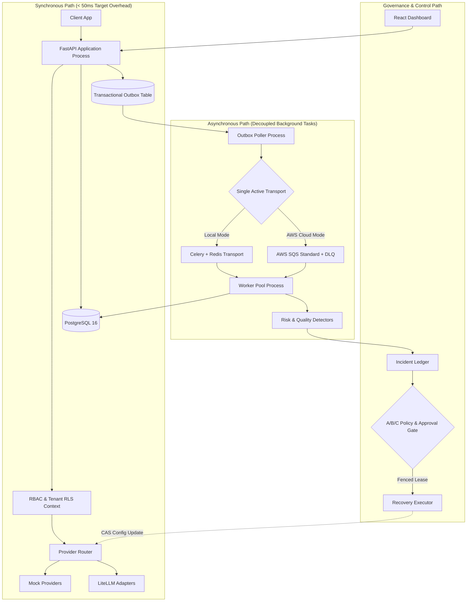

# ADR-0001: Architecture Style, Stack Evolution, and Transport Strategy

> **Status:** Accepted  
> **Date:** 2026-11-08  
> **Deciders:** SentinelAI Architecture Team  
> **Document:** `docs/architecture/ADR-0001-modular-monolith.md`

---

## 1. Context and Problem Statement

SentinelAI requires a scalable, maintainable foundation capable of supporting six core modules: AI Gateway, Observability Engine, AI Quality Evaluator, Risk Detection Engine, Recovery Orchestrator, and Control Dashboard.

Initial project explorations considered multiple concurrent technologies:
- Decomposing the system immediately into 5+ distributed microservices.
- Running Apache Kafka alongside Celery and Redis.
- Orchestrating recovery remediation using LangGraph agents with direct tool access.
- Deploying the MVP to Kubernetes from Day 1.

We must decide:
1. What architectural pattern provides maximum developer velocity and operational safety for the core product?
2. How should asynchronous telemetry transports evolve from local development to cloud production without duplicating message infrastructure?
3. How should advanced technologies (Kafka, LangGraph, Kubernetes) be positioned relative to the MVP release?

---

## 2. Decision Drivers

- **Operational Simplicity & Cost:** Running multi-node clusters, Kafka brokers, and Kubernetes locally or in the cloud imposes severe overhead ($> \$150/\text{month}$ and complex dev environments).
- **Correctness Before Distribution:** Multi-tenant RLS, transactional outbox guarantees, and idempotency are vastly easier to prove and test inside a single cohesive data model than across distributed boundaries.
- **Single Active Transport Rule:** Maintaining multiple active message queues in the same environment causes divergent delivery semantics, duplicate serialization logic, and doubled operational maintenance.
- **Security & Authorization Boundaries:** Infrastructure remediation must be governed by deterministic state machines, not stochastic LLM agents.

---

## 3. Considered Options

* **Option 1: Premature Microservices with Kafka & Kubernetes from Day 1**
* **Option 2: Modular Monolith with Celery/Redis Locally, SQS on AWS, and Gated Post-MVP Labs** *(Selected)*
* **Option 3: Pure Synchronous Monolith (No Queue)**

---

## 4. Decision Outcome

**Chosen Option: Option 2 (Modular Monolith with Transport Port and Gated Labs)**

### 4.1. Core Architectural Style: Modular Monolith
SentinelAI will be constructed as a **modular monolith** in Python 3.12+ using FastAPI, Pydantic v2, and async SQLAlchemy 2.0:
- All domain modules (`gateway`, `telemetry`, `eval`, `detectors`, `recovery`, `auth`) reside within `backend/app/`.
- Clear internal boundaries are enforced via strict interface contracts and package modularity.
- The synchronous API and asynchronous workers share domain models and PostgreSQL access, but execute in separate, independently scalable OS processes.
- Microservice extraction is explicitly deferred until empirical performance telemetry proves an unresolvable bottleneck.

### 4.2. Asynchronous Transport Strategy: Single Active Transport
To eliminate conflicting delivery semantics:
- SentinelAI introduces a clean **Queue Port abstraction** (`backend/app/queue/port.py`).
- **Local Development & Testing:** Single active transport is **Celery + Redis 7**.
- **AWS Cloud Production:** Single active transport is **AWS SQS Standard + DLQ**, sharing identical worker handlers.
- **Rule:** Only *one* telemetry transport is active in any given runtime environment.

### 4.3. Resolution of Advanced Concept Technologies
- **Apache Kafka:** Isolated to optional post-MVP comparison labs (**Days 85–86**). It will not run alongside the Celery/SQS MVP.
- **LangGraph:** Isolated to optional advisory planning labs (**Days 87–88**). It may propose typed recovery plans, but will never hold execution authorization.
- **Kubernetes:** Isolated to optional platform comparison labs (**Days 89–90**). The primary cloud target remains lightweight AWS ECS Fargate.

---

## 5. Architectural Topology

---

## 6. Consequences & Trade-offs

### Positive Consequences
- **Rapid Local Setup:** The entire platform boots in $< 30\text{ seconds}$ using Docker Compose (`docker compose up postgres redis`).
- **Data Integrity:** The Transactional Outbox pattern guarantees at-least-once telemetry delivery without two-phase commit (2PC) or distributed transaction managers.
- **Auditability:** Unified PostgreSQL schema allows atomic foreign key references between requests, outbox events, incidents, and recovery audit trails.
- **Cost Discipline:** Local development uses zero cloud spend; AWS footprint stays well within the $\$20/\text{month}$ budget guardrail.

### Negative Consequences / Accepted Risks
- Single database instance is a potential single point of failure (mitigated by read replicas and RDS managed backups in production).
- Modules could accidentally leak abstractions across internal boundaries if developers bypass contract interfaces (mitigated by strict linter checks and Mypy typing in CI).

