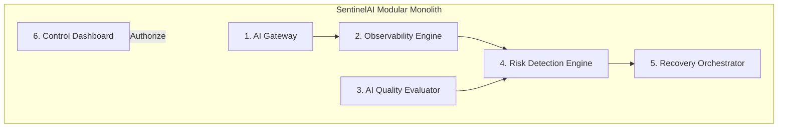

# SentinelAI — Product Scope & Architectural Specification

> **Status:** Approved Baseline  
> **Document:** `docs/product/project-brief.md`  
> **Version:** 1.0.0 (Day 001)

---

## 1. Executive Summary & Vision

**SentinelAI** is an enterprise-grade AI Operations (AIOps) and Reliability Platform built to operate Large Language Model (LLM) applications safely in production. 

Rather than merely proxying LLM requests, SentinelAI addresses the operational, financial, and security failure modes that emerge when commercial providers, asynchronous queues, configurations, and recovery mechanisms fail. It provides deterministic boundaries around AI models, ensuring strict multi-tenant isolation, tamper-evident auditability, cost control, transparent risk scoring, and fenced, policy-governed automated recovery.

---

## 2. The Six Core Modules

SentinelAI is architected as a **modular monolith** organized into six functional modules:



### Module 1: AI Gateway (Synchronous Critical Path)
- **Responsibility:** Unified ingress for multi-model LLM traffic (via LiteLLM adapters and deterministic mock providers).
- **Key Functions:**
  - Enforces API authentication, tenant context, and role-based permissions (RBAC).
  - Handles request budgets (token count and spend limits) and token-bucket rate limits.
  - Guarantees payment idempotency via pre-call intent ledgers (`PENDING` state).
  - Prevents blind replaying of ambiguous timeouts (`UNKNOWN` status).
  - Writes metadata events to the Transactional Outbox within the same database transaction.

### Module 2: Observability Engine (Asynchronous Ingestion & Telemetry)
- **Responsibility:** Ingests execution telemetry without adding synchronous latency to the gateway.
- **Key Functions:**
  - Transactional Outbox pattern backed by PostgreSQL.
  - Active asynchronous transport: Celery + Redis (Local MVP) or AWS SQS Standard + DLQ (Cloud Production).
  - OpenTelemetry W3C distributed tracing across Gateway, Queue, and Background Workers.
  - Prometheus metrics exporter (`/metrics`) and Grafana monitoring dashboards.
  - 1-minute, 5-minute, and 1-hour time-series rollups for latency (p50/p95/p99), token burn, error rates, and costs.

### Module 3: AI Quality Evaluator (Offline & Sampled Evaluation)
- **Responsibility:** Evaluates model outputs for groundedness, answer relevance, and hallucination risk without compromising privacy.
- **Key Functions:**
  - In-memory feature extraction (lexical overlap, repetition, compression ratio) before prompt content is discarded.
  - Groundedness evaluation marked `UNAVAILABLE` (not false zero) when reference context is absent.
  - Standardized 200-case synthetic golden benchmark dataset with a 50/50 blind train/test split.
  - Calibration engine reporting inter-rater agreement (Cohen's Kappa), precision, recall, and false positive rates.

### Module 4: Risk Detection Engine (Statistical & Deterministic Anomaly Engine)
- **Responsibility:** Scans aggregated telemetry and quality signals to detect operational regressions and incidents.
- **Key Functions:**
  - Outage and error spike detector (5xx errors, provider connection drops).
  - Latency regression detector (rolling window baseline comparison).
  - Cost anomaly detector (Z-score spike detection on token consumption).
  - Configuration/Prompt regression detector correlating version activations with performance degradation.
  - Generates transparent 0–100 risk scores with human-readable factor attributions.
  - Deduplicating incident manager with lifecycle transitions (`OPEN`, `ACKNOWLEDGED`, `RESOLVED`).

### Module 5: Recovery Orchestrator (Policy-Governed Remediation)
- **Responsibility:** Executes mitigation actions to restore degraded services safely and deterministically.
- **Key Functions:**
  - Strict **A/B/C Policy Partitioning**:
    - **Category A:** Automatic within preapproved rate/budget thresholds (e.g. temporary circuit breaking to healthy fallback model).
    - **Category B:** Requires human approval with cryptographic 15-minute expiring lease tokens (e.g. prompt rollback, traffic rerouting).
    - **Category C:** Manual only; strictly forbidden from automation (e.g. database schema migrations, credential rotation, tenant deletion).
  - Distributed fenced execution tokens to eliminate split-brain dual executions.
  - Immutable configuration rollback with compare-and-swap (CAS).
  - **Zero Model Autonomy Rule:** LLMs and Evaluators cannot execute recovery actions; they only output advisory incident proposals.

### Module 6: Control Dashboard (Operational Web UI)
- **Responsibility:** Single-pane-of-glass operator interface for real-time telemetry, incidents, and approvals.
- **Key Functions:**
  - React 18, TypeScript, Vite, Tailwind CSS, Recharts.
  - Dark-mode first enterprise dashboard with sub-second navigation.
  - Request history explorer with cursor pagination and metadata drilldown drawers.
  - Live incident feed with one-click Category B approval and rollback modals.
  - Secure session handling: in-memory access tokens and HttpOnly secure cookie refresh rotation (zero localStorage token storage).

---

## 3. Seven Core Failure Stories & Mitigation Contracts

| Failure Story | Real-World Scenario | SentinelAI Deterministic Mitigation |
|---|---|---|
| **1. Provider Outage** | Primary LLM provider experiences 503 outage or TLS connection reset. | Circuit breaker opens (`CLOSED` -> `OPEN`), router shifts traffic to secondary provider or deterministic mock within 1 retry; Category A automatic failover triggered. |
| **2. Latency Degradation** | Provider p99 latency spikes from 800ms to 9,000ms, stalling client threads. | Rolling window detector flags SLO breach; dynamic timeout aborts hung requests; tenant rate-limiter throttles concurrent calls. |
| **3. Runaway Cost Spikes** | Application bug causes recursive agent loop or 100k token context flooding. | Pre-call budget check enforces application-level and tenant-level spend limits; request rejected with 429/402 before reaching provider. |
| **4. Prompt Regression** | New prompt version deployed that increases hallucination rate or breaks schema. | Correlates version deployment timestamp with drop in quality features; surfaces Category B rollback recommendation with diff preview. |
| **5. Ambiguous Provider Timeouts** | Gateway times out after 30s while upstream provider successfully generated and billed response. | Request logged as `UNKNOWN`; idempotency key claims the slot; automated replay is strictly prohibited to prevent duplicate billing. |
| **6. Broker Partition & Worker Backlog** | Redis restarts or worker pool crashes under heavy traffic load. | Transactional outbox retains events safely in PostgreSQL; poller uses bounded exponential backoff; dead-letter queue (DLQ) captures poison messages after 5 attempts. |
| **7. Split-Brain Recovery Race** | Two operators or worker nodes attempt conflicting failover actions simultaneously. | Fenced execution engine verifies monotonic lock counter and valid lease token; stale execution is immediately rejected. |

---

## 4. User Roles & RBAC Matrix

SentinelAI enforces four standardized roles across all organizations:

| Role | Description | Permissions |
|---|---|---|
| **Owner** | Organization creator / Billing owner | Full tenant control: manage billing, invite Admins, manage all API keys, execute Category B/C recovery, delete applications. |
| **Admin** | Engineering manager / DevOps lead | Manage applications, manage provider credentials, approve Category B actions, configure detectors and alerts. |
| **Operator** | SRE / On-call engineer | View real-time telemetry, acknowledge incidents, trigger manual failovers within approved boundaries, view audit logs. |
| **Viewer** | Developer / Business analyst | Read-only access to dashboards, request histories, latency/cost rollups, and quality evaluation reports. |

---

## 5. Request Lifecycle: Synchronous vs. Asynchronous Paths

```mermaid
sequenceDiagram
    autonumber
    actor Client
    participant GW as API Gateway (Sync)
    participant PG as PostgreSQL (RLS)
    participant Ext as LLM Provider
    participant Box as Transactional Outbox
    participant Q as Transport (Celery/SQS)
    participant W as Workers (Async)

    Client->>GW: POST /api/v1/gateway/chat/completions
    GW->>GW: Auth (JWT/API Key) & Rate Limit Check
    GW->>PG: SET LOCAL app.current_tenant; Check Budget & Claim Idempotency
    GW->>Ext: Invoke Provider (Timeout: 15s)
    Ext-->>GW: Provider Response (or Error)
    GW->>PG: Commit Response, Update Attempt Ledger & Insert Outbox Event
    GW-->>Client: 200 OK (Response Payload)
    
    Note over Box,W: Asynchronous Processing Loop (Zero Impact on Client Latency)
    Box->>Q: Poller publishes event
    Q->>W: Worker dequeues event
    W->>W: Deduplicate & Extract In-Memory Quality Features
    W->>PG: Store Window Aggregate & Risk Check
    W->>Q: Acknowledge message (or DLQ on failure)
```

---

## 6. Project Scope Boundaries (MVP vs. Non-Goals)

### In-Scope for Core MVP (Days 01–84)
- Python 3.12+ modular monolith with FastAPI and async SQLAlchemy.
- PostgreSQL 16 with Row-Level Security (RLS) and non-owner application role.
- Transactional Outbox with Celery + Redis for local development.
- Swappable queue port supporting AWS SQS Standard + DLQ in cloud mode.
- LiteLLM integration alongside robust deterministic fake providers.
- Strict idempotency ledger preventing duplicate billing on uncertain timeouts.
- In-memory bounded quality feature extraction.
- 200-case synthetic golden benchmark with Cohen's Kappa calibration.
- Category A/B/C recovery state machine with fenced execution.
- React 18 + Vite + TypeScript dashboard with Recharts visualizations.
- OpenTelemetry distributed tracing and Prometheus metrics.
- Terraform-managed low-cost AWS deployment with budget kill-switch ($20 cap).

### Explicit Non-Goals / Post-Release Labs (Days 85–90)
- **No dual active message queues:** We will never run Kafka and Celery/SQS concurrently in production. Kafka is isolated to Days 85–86 as an optional lab.
- **No LLM tool-calling in recovery:** LangGraph (Days 87–88) is evaluated strictly as an advisory proposal generator; it will never be granted execution credentials.
- **No Kubernetes prerequisite for MVP:** Kubernetes (Days 89–90) is an optional deployment comparison; the production target is lightweight AWS ECS Fargate.
- **No full prompt content storage:** SentinelAI prioritizes user privacy. Raw prompt text is ephemeral and discarded after gateway transit unless explicitly opted into temporary diagnostic retention.

---

## 7. Labeled Performance Targets (Targets vs. Achieved Results)

> **Important Portfolio Rule:** The following figures are design **targets** to be empirically benchmarked, not pre-claimed results. Actual measurements will be populated during Week 10 (Locust load tests).

- **Gateway Overhead Latency Target:** $< 50\text{ms}$ added to provider response time at p95.
- **Gateway Throughput Target:** $\ge 200\text{ RPS}$ on single local standard instance.
- **Tenant Isolation Target:** $100\%$ zero-leakage across pooled connections (verified by negative test suite).
- **Outbox Worker Latency Target:** Event ingested to aggregated metric $< 2.5\text{s}$ at p95.
- **Evaluator Calibration Target:** Cohen's $\kappa \ge 0.70$ agreement with ground-truth labels on 200-case test set.
- **AWS Monthly Operational Cost Cap:** $< \$25/\text{month}$ during active cloud testing phases.

