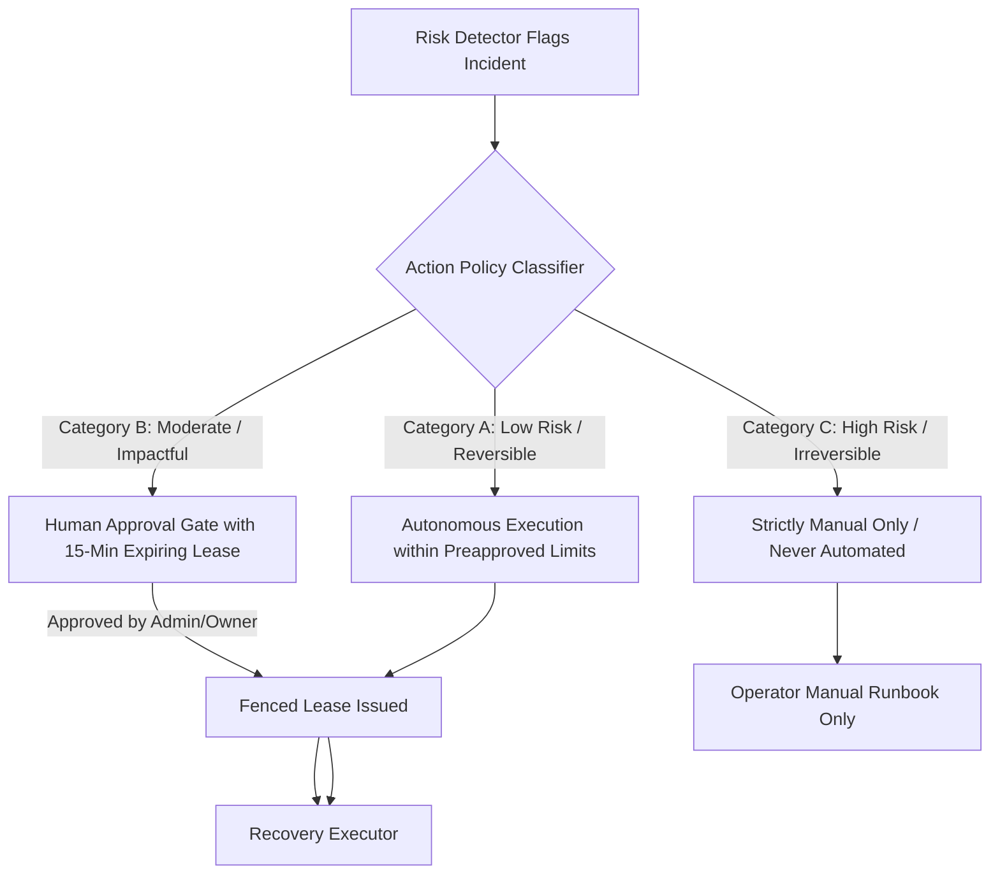

# SentinelAI — Recovery A/B/C Policy & Fenced Execution Specification

> **Status:** Approved Baseline  
> **Document:** `docs/security/recovery-policy.md`  
> **Version:** 1.0.0 (Day 001)

---

## 1. Core Principle: Recovery is Authorization, Not Text Generation

In an enterprise AI Gateway, automated remediation must be strictly constrained by deterministic server-side policies, cryptographic leases, and authorization checks. 

**Fundamental Law:** Under no circumstances may an AI model, prompt evaluator, or agentic framework possess direct tool-execution authority or autonomously trigger infrastructure changes. Model outputs are strictly advisory incident signals.

---

## 2. The A/B/C Recovery Policy Classification

All remediation actions supported by SentinelAI are partitioned into three immutable tiers:

### Classification Matrix

| Action | Category | Trigger Condition | Preapproved Constraints & Guardrails | Authorization Required | Rollback Mechanism |
|---|---|---|---|---|---|
| **Temporary Circuit Breaker Trip** | **Category A** | Provider error rate > 50% over 60s, or 3 consecutive 5xx errors | Max duration: 5 minutes. Fallback to secondary model or deterministic mock. Rate: max 2 trips per hour. | Automated (System Service Role) | Automatic transition to `HALF_OPEN` after cooldown period. |
| **Tenant Rate Throttle** | **Category A** | Tenant exceeds token budget by 120% or generates > 300 RPM spike | Max reduction: 50% base quota. Cooldown: 15 minutes. | Automated (System Service Role) | Automatic quota restoration after metric normalizes. |
| **Model Route Failover** | **Category B** | Primary model outage confirmed across > 2 regions for > 3 minutes | Must target verified healthy endpoint. Cost variance cannot exceed +25% without explicit override. | **Human Operator / Admin** (via signed JWT approval token, 15m TTL) | One-click instant failover reversal to primary. |
| **Prompt / Config Rollback** | **Category B** | Quality regression detected immediately (< 15 mins) following a prompt/route update | Can only roll back to immediately preceding active version with verified baseline scores. | **Human Operator / Admin** (requires viewing diff preview before signing) | CAS activation of previous version ID. |
| **Database Schema Migration / Downgrade** | **Category C** | Alembic migration failure or corrupted state | **Never Automated.** CLI manual invocation only. | Manual terminal access by authorized DBA | Manual migration rollback script. |
| **Tenant Key Revocation & Lockout** | **Category C** | Critical credential leak suspected or malicious tenant behavior | **Never Automated.** Prevents accidental business disruption. | Organization Owner or Security Admin only | Manual re-issue through administrative panel. |
| **Resource Purge / Database Deletion** | **Category C** | Tenant offboarding or storage reclamation | **Never Automated.** Irreversible data destruction. | Explicit multi-party manual confirmation | Cold backups only. |

---

## 3. Fenced Lease & Monotonic Execution Tokens

To prevent **Split-Brain Dual Execution** (e.g. two distributed workers or multiple operators attempting conflicting failovers simultaneously):

1. **Monotonic Sequence Token:** Every recovery lease issues a strictly incrementing 64-bit integer fencing token ($T_N$).
2. **Resource Version Lock:** Target resources (e.g., active route configuration) maintain a `last_fencing_token` field in PostgreSQL.
3. **Compare-And-Swap (CAS):**
   $$\text{UPDATE configuration SET target = :new, last_fencing_token = } T_N \text{ WHERE last_fencing_token } < T_N;$$
   If an earlier lease attempts to write after a newer lease has committed, the transaction is rejected.
4. **Expiring Cryptographic Lease:** Approvals for Category B actions contain a signed SHA-256 token valid for exactly 15 minutes ($900\text{s}$). Stale approvals cannot be replayed.

---

## 4. Immutable Audit Ledger

Every recovery invocation—whether automated (Category A) or human-authorized (Category B)—must write an immutable entry to `recovery_audit_log` within the execution transaction:

- `audit_id`: UUIDv7 (time-ordered).
- `tenant_id`: Organization UUID.
- `action_type`: String (e.g., `CIRCUIT_BREAKER_TRIP`, `ROUTE_FAILOVER`).
- `category`: `A` or `B`.
- `authorized_by`: User UUID or `SYSTEM_AUTONOMOUS_POLICY`.
- `triggering_incident_id`: UUID reference to the incident record.
- `fencing_token`: Monotonic integer.
- `state_diff`: Redacted JSONB representation of previous vs. new configuration.
- `timestamp`: UTC ISO 8601.

