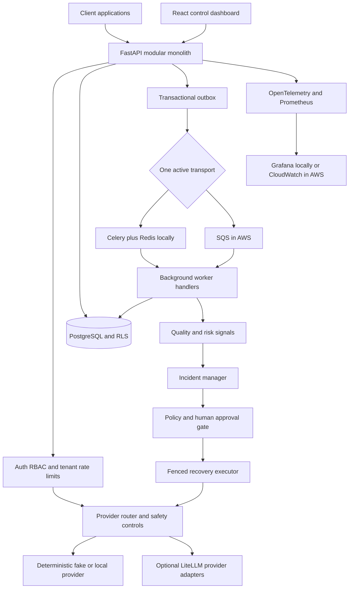

# SentinelAI — 84 core days + 6 optional advanced days

This roadmap turns the detailed SentinelAI brief into daily implementation work. **The project application has not been built yet.** These guides tell you what to build, how to approach it, why it matters, which earlier work it depends on, the workflow to follow, and how to prove the day is complete.

## Analysis of the brief

SentinelAI is one product with six modules: AI Gateway, Observability Engine, AI Quality Evaluator, Risk Detection Engine, Recovery Orchestrator, and Control Dashboard. The strongest engineering idea is not merely calling an LLM; it is operating an AI system safely when providers, queues, configurations, and recovery actions fail.

The detailed brief is the primary implementation track. It explicitly chooses a **modular monolith**, **Celery + Redis first**, then **AWS SQS and ECS Fargate**. The earlier concept suggested Kafka, LangGraph, and Kubernetes. Those are useful extensions, but running them alongside the MVP stack would add operational cost and duplicate responsibilities. Therefore:

- **Days 1–84:** the complete 12-week core plan from the detailed brief.
- **Days 85–90:** optional post-release labs for Kafka, LangGraph, and local Kubernetes.
- Only one telemetry transport is active in an environment: Celery/Redis locally, SQS in the AWS environment, or Kafka in an isolated comparison lab.
- LangGraph may propose typed recovery plans; the existing authenticated policy/approval/executor layer remains the only authority that can mutate production state.
- Kubernetes is an optional deployment comparison, not a prerequisite for the MVP or AWS ECS release.

### Design issues resolved before implementation

1. **Telemetry privacy vs. quality evaluation.** Metadata-only events cannot support full-content groundedness later. Fast deterministic checks run in memory before content is discarded. Deeper evaluation uses offline fixtures or explicitly opt-in, encrypted, short-retention diagnostic samples. Groundedness is `unavailable`, not zero, when its inputs are absent.
2. **Paid retries are ambiguous.** A timeout does not prove the provider did not execute and bill a request. Record an attempt before calling the provider; mark uncertain outcomes `UNKNOWN`; never automatically replay them. Database idempotency alone cannot guarantee exactly-once provider billing.
3. **Queue delivery is at least once.** Use a transactional outbox, durable broker acknowledgement, consumer deduplication in the same transaction as effects, bounded retries, and a dead-letter path. SQS messages are deleted only after the database commit.
4. **Tenant isolation is foundational.** PostgreSQL Row-Level Security runs under a non-owner application role. Every transaction sets tenant context safely; tests prove that missing or foreign context cannot expose another organization.
5. **Recovery is authorization, not text generation.** Immutable configurations, append-only audit, expiring approvals, server-side policy checks, leases, and fencing tokens exist before failover or rollback. Model output cannot invoke recovery tools.
6. **Quality signals are not proof.** A low groundedness or relevance score is evidence for investigation, not a definitive hallucination label. Track evaluator versions, human labels, false positives, and unavailable signals.
7. **Cloud work is gated.** Terraform plans are the default. AWS apply, public exposure, image push to a remote registry, and teardown require explicit approval, a current cost estimate, synthetic data, and a teardown plan. A local-only release is valid and must be described honestly.
8. **Measurements must be real.** SLOs and coverage numbers are targets until tested. Reports include date, commit, hardware, configuration, workload, and actual results. Never replace placeholders with invented numbers.

## Core architecture

The API and workers share domain code and PostgreSQL, but deploy as separate processes. The synchronous request path contains authentication, validation, routing, provider execution, and response delivery. Analytics, evaluation, incident analysis, and aggregation run asynchronously.

## Stack and evolution

| Concern | Core MVP | Later / optional |
|---|---|---|
| API | Python 3.12+, FastAPI, Pydantic | Separate services only if measured need |
| Providers | Deterministic fakes, local model, LiteLLM | Capped OpenAI / Anthropic checks |
| Data | PostgreSQL, SQLAlchemy 2, Alembic, RLS | Partitioning only after measurement |
| Local async work | Celery + Redis, transport port | Kafka lab, Days 85–86 |
| Cloud async work | SQS Standard + DLQ, shared handlers | FIFO only if ordering requirements justify it |
| Recovery | Deterministic policy/state machine | LangGraph proposal planner, Days 87–88 |
| Dashboard | React, TypeScript, Recharts | Advanced analytics |
| Observability | OpenTelemetry, Prometheus, Grafana | CloudWatch in AWS |
| Delivery | Docker Compose, GitHub Actions | AWS ECS/Terraform; local K8s Days 89–90 |
| Security | Argon2, JWT/RBAC, RLS, hashed keys, audit | Secrets Manager, KMS, least-privilege IAM |
| Tests | Pytest, Locust, local fault injection | Bandit, Semgrep, pip-audit, Trivy, local ZAP |

## How to use the daily guides

1. Work through Days 1–84 in order. Each is designed for roughly **2–3 focused hours**; dataset, integration, and cloud days may take longer.
2. Every seventh day is a checkpoint/buffer. Use it to finish acceptance checks or catch up instead of starting new features.
3. Open the day's guide and read **Previous work done**. That section lists every earlier step and its expected result. It is a prerequisite checklist, not a claim that you have already completed it.
4. Follow What → Why → How → Workflow → Checks. Keep each day's change small enough to review.
5. Do not advance past a failing safety, tenant-isolation, idempotency, or approval test. Use the checkpoint day to repair it.
6. Mark the checkbox below only when the guide's acceptance checks pass. Record actual test evidence in the future repository.
7. Days 85–90 are optional. Complete the core release first. The pairs are independent after Day 84: 85–86 Kafka, 87–88 LangGraph, and 89–90 Kubernetes. Complete both days of a chosen pair; other pairs may remain deferred. Immediate dependencies in each guide are authoritative.

### Environment and command conventions

- Develop in the repository root: `C:/Users/avina/OneDrive/Desktop/SentinelAI`. Do not create another nested `sentinel-ai` folder.
- Commands use **Git Bash on Windows**. Activate Python with `source .venv/Scripts/activate`; in PowerShell the equivalent is `.\.venv\Scripts\Activate.ps1`.
- Install Python packages **only into `.venv`**, using `.venv/Scripts/python -m pip ...`. Never use global pip.
- Use Python 3.12+, Git, Docker Desktop with Compose, and a current Node.js LTS release. Install Terraform, AWS CLI, and kind/k3d only when their phases begin.
- Keep Docker/Compose data in named volumes rather than bind-mounting live database files into OneDrive.
- Pin dependencies and container digests when introduced. Verify current library APIs, GitHub Action versions, AWS behavior, Free Tier rules, and prices on the relevant day; this roadmap intentionally does not freeze stale versions.
- Default to fake providers and synthetic prompts. Real-provider checks need credentials, an explicit spend cap, and a separate opt-in test marker.
- Suggested commit messages are checkpoints for your future workflow. This roadmap creation does not initialize Git, commit, push, install dependencies, or provision cloud resources.

## Requirement coverage

| Brief requirement | Main days |
|---|---|
| Six-module modular architecture and ADRs | 1–7, 78 |
| Multi-organization data, four roles, RLS, keys, audit | 8–14, 60 |
| Unified gateway, LiteLLM, timeouts, streaming, idempotency | 15–21 |
| Outbox, Celery/Redis workers, tracing, metrics | 22–28 |
| Latency/token/error/cost APIs and React dashboard | 29–35 |
| Deterministic/statistical risk detection and incidents | 36–42 |
| 200-case quality benchmark, evaluators, calibration | 35, 42–49 |
| A/B/C recovery policy, approvals, failover, throttle, rollback | 50–56 |
| Failure injection, prompt-injection boundary, privacy, scanners | 57–63 |
| Locust, SLOs, query tuning, cost and benchmark reports | 64–70 |
| AWS budgets, Terraform, SQS, ECS, RDS, secrets, monitoring | 71–77 |
| Documentation, demo, interview preparation, release | 78–84 |
| Kafka / LangGraph / Kubernetes from the original concept | 85–90, optional |

## Progress index

### Week 1 — Foundation and architecture
- [x] [Day 01 — Define the product scope and safety contract](step-001.md)
- [x] [Day 02 — Initialize the repository and Python environment](step-002.md)
- [ ] [Day 03 — Add the local quality and security gate](step-003.md)
- [ ] [Day 04 — Start PostgreSQL and Redis with Docker Compose](step-004.md)
- [ ] [Day 05 — Connect SQLAlchemy and create the Alembic baseline](step-005.md)
- [ ] [Day 06 — Build the FastAPI application shell](step-006.md)
- [ ] [Day 07 — Verify the foundation from a clean setup](step-007.md)

### Week 2 — Authentication, tenant isolation, and versioning
- [ ] [Day 08 — Model organizations users applications and roles](step-008.md)
- [ ] [Day 09 — Apply tenant schema migrations and database grants](step-009.md)
- [ ] [Day 10 — Enforce PostgreSQL row-level security](step-010.md)
- [ ] [Day 11 — Prove cross-tenant isolation with negative tests](step-011.md)
- [ ] [Day 12 — Add dashboard login JWT sessions and RBAC](step-012.md)
- [ ] [Day 13 — Manage applications API keys and append-only audit](step-013.md)
- [ ] [Day 14 — Version provider configurations and prompts](step-014.md)

### Week 3 — Working LLM gateway
- [ ] [Day 15 — Define LLM contracts and deterministic fake providers](step-015.md)
- [ ] [Day 16 — Integrate LiteLLM and gated real-provider adapters](step-016.md)
- [ ] [Day 17 — Record paid attempts and enforce idempotency](step-017.md)
- [ ] [Day 18 — Handle ambiguous provider outcomes safely](step-018.md)
- [ ] [Day 19 — Build the provider router and request budgets](step-019.md)
- [ ] [Day 20 — Add streaming cancellation and tenant rate limits](step-020.md)
- [ ] [Day 21 — Verify the complete fake-provider gateway](step-021.md)

### Week 4 — Asynchronous telemetry and observability
- [ ] [Day 22 — Design telemetry events and the transactional outbox](step-022.md)
- [ ] [Day 23 — Build the queue port and Celery Redis transport](step-023.md)
- [ ] [Day 24 — Make background workers idempotent and retry-safe](step-024.md)
- [ ] [Day 25 — Add OpenTelemetry tracing across API and workers](step-025.md)
- [ ] [Day 26 — Expose Prometheus metrics and provision Grafana](step-026.md)
- [ ] [Day 27 — Test queue failures redelivery and backpressure](step-027.md)
- [ ] [Day 28 — Verify end-to-end telemetry and privacy](step-028.md)

### Week 5 — Metrics, cost, and monitoring dashboard
- [ ] [Day 29 — Build latency error and token rollups](step-029.md)
- [ ] [Day 30 — Calculate costs with versioned pricing](step-030.md)
- [ ] [Day 31 — Expose request metrics and cost APIs](step-031.md)
- [ ] [Day 32 — Scaffold the React TypeScript dashboard](step-032.md)
- [ ] [Day 33 — Visualize latency errors tokens and cost](step-033.md)
- [ ] [Day 34 — Add request history and metadata drill-down](step-034.md)
- [ ] [Day 35 — Verify the monitoring MVP and label first cases](step-035.md)

### Week 6 — Risk detection and incidents
- [ ] [Day 36 — Build the detector framework and latency checks](step-036.md)
- [ ] [Day 37 — Detect outages cost spikes and traffic anomalies](step-037.md)
- [ ] [Day 38 — Detect configuration and prompt regressions](step-038.md)
- [ ] [Day 39 — Calculate transparent risk scores](step-039.md)
- [ ] [Day 40 — Create incidents with deduplication and audit](step-040.md)
- [ ] [Day 41 — Expose incident APIs and dashboard panels](step-041.md)
- [ ] [Day 42 — Verify detection and expand the quality dataset](step-042.md)

### Week 7 — AI quality evaluation
- [ ] [Day 43 — Define evaluation contracts and labeling rubric](step-043.md)
- [ ] [Day 44 — Complete the 200-case dataset and blind split](step-044.md)
- [ ] [Day 45 — Extract bounded quality features without storing content](step-045.md)
- [ ] [Day 46 — Calibrate evaluators and measure agreement](step-046.md)
- [ ] [Day 47 — Connect quality signals to risk scoring](step-047.md)
- [ ] [Day 48 — Evaluate regressions asynchronously with optional frameworks](step-048.md)
- [ ] [Day 49 — Verify reproducible quality evaluation](step-049.md)

### Week 8 — Safe recovery orchestration
- [ ] [Day 50 — Encode recovery policies and action contracts](step-050.md)
- [ ] [Day 51 — Implement expiring human approvals](step-051.md)
- [ ] [Day 52 — Build the fenced recovery executor](step-052.md)
- [ ] [Day 53 — Add circuit breakers and approved failover](step-053.md)
- [ ] [Day 54 — Add bounded throttling and safe retries](step-054.md)
- [ ] [Day 55 — Roll back configurations and verify recovery](step-055.md)
- [ ] [Day 56 — Test recovery crashes races and escalation](step-056.md)

### Week 9 — Reliability and security
- [ ] [Day 57 — Exercise the provider failure matrix](step-057.md)
- [ ] [Day 58 — Exercise infrastructure and dependency failures](step-058.md)
- [ ] [Day 59 — Test the prompt-injection trust boundary](step-059.md)
- [ ] [Day 60 — Harden tenant access and API key lifecycle](step-060.md)
- [ ] [Day 61 — Implement privacy modes and diagnostic retention](step-061.md)
- [ ] [Day 62 — Run security scanners and remediate findings](step-062.md)
- [ ] [Day 63 — Publish measured security and failure reports](step-063.md)

### Week 10 — Scalability and benchmarks
- [ ] [Day 64 — Benchmark normal gateway traffic with Locust](step-064.md)
- [ ] [Day 65 — Benchmark traffic spikes soak and worker backlog](step-065.md)
- [ ] [Day 66 — Measure failover and worker recovery](step-066.md)
- [ ] [Day 67 — Tune database queries and decide on partitioning](step-067.md)
- [ ] [Day 68 — Report LLM retry evaluation and infrastructure costs](step-068.md)
- [ ] [Day 69 — Evaluate SLOs coverage and performance regressions](step-069.md)
- [ ] [Day 70 — Finalize the benchmark report](step-070.md)

### Week 11 — Cost-conscious AWS deployment
- [ ] [Day 71 — Prepare AWS budgets identity and approval gates](step-071.md)
- [ ] [Day 72 — Plan low-cost AWS resources with Terraform](step-072.md)
- [ ] [Day 73 — Implement and test the SQS transport](step-073.md)
- [ ] [Day 74 — Plan the full AWS topology and delivery pipeline](step-074.md)
- [ ] [Day 75 — Deploy a short-lived AWS test environment](step-075.md)
- [ ] [Day 76 — Drill AWS recovery and queue cutover](step-076.md)
- [ ] [Day 77 — Tear down AWS resources and verify costs](step-077.md)

### Week 12 — Documentation and portfolio release
- [ ] [Day 78 — Complete architecture and operator documentation](step-078.md)
- [ ] [Day 79 — Verify the API quickstart from a clean clone](step-079.md)
- [ ] [Day 80 — Assemble measured release evidence](step-080.md)
- [ ] [Day 81 — Build and rehearse the synthetic demo](step-081.md)
- [ ] [Day 82 — Prepare interview explanations and resume evidence](step-082.md)
- [ ] [Day 83 — Polish the GitHub repository and release candidate](step-083.md)
- [ ] [Day 84 — Accept the MVP release and record the backlog](step-084.md)

### Optional Week 13 — Advanced extensions
- [ ] [Day 85 — Optional Kafka lab setup and transport parity](step-085.md)
- [ ] [Day 86 — Optional Kafka benchmarks and adoption decision](step-086.md)
- [ ] [Day 87 — Optional LangGraph proposal planner](step-087.md)
- [ ] [Day 88 — Optional LangGraph approvals and bypass tests](step-088.md)
- [ ] [Day 89 — Optional local Kubernetes deployment](step-089.md)
- [ ] [Day 90 — Optional Kubernetes operations and platform decision](step-090.md)

## Core release definition

Day 84 is complete only when the local fake-provider product supports the six modules; tenant isolation and recovery authorization tests pass; queue effects are idempotent; quality evaluation has a reproducible 200-case report; failures have measured behavior; setup works from a clean clone; and documentation distinguishes implemented, tested, optional, and unverified capabilities. AWS deployment may be marked **not executed** for budget reasons without falsifying the release. Kafka, LangGraph, and Kubernetes remain optional extensions rather than hidden release requirements.